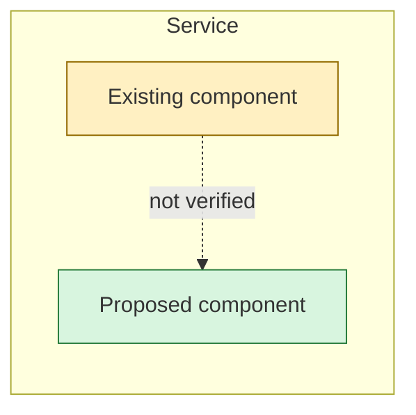

# /approach: Design a Heavy change

## Step 1: Load the writing rule

Read `.claude/rules/writing-standard.md` before you write anything.
Use the framework's controlled technical writing profile.

## Step 2: Read the work safely

Resolve the code repository from the reference or its origin remote. Keep its explicit `owner/repo` as `$repo`.
Resolve the ops root through `docs/skills/shared/ops-root.md`.
Read `roles/engineering/tech-lead.md` and run as the Tech Lead.
The Solution Architect reviews the design and never authors it.

For a PR, read its state before any write:

```bash
gh pr view "$number" --repo "$repo" --json state,title,body,files,baseRefOid,headRefOid
```

If its state is MERGED, print only this refusal line and stop:

```text
Refused: PR <ref> is already merged.
```

Read the ticket text, acceptance criteria, named files, and relevant PR diff:

```bash
gh issue view "$ticket" --repo "$repo" --json title,body,labels
gh pr diff "$number" --repo "$repo"
```

Every gh call must pass `--repo`. Do not infer missing ticket content or a missing PR state.
When a source cannot be read, record `not checked` with the source and reason.
If the reference or PR state remains unknown, stop and request the missing evidence.

Inspect `git status --porcelain` and the active ticket marker before any write, including writes by delegated skills.
Check tracked and untracked changes. Do not treat a clean branch name as proof of ticket ownership.
Never write into a tree with uncommitted changes for another ticket or unknown ownership.
Use a dedicated worktree through `.claude/rules/isolated-builds.md` when authorized.
Otherwise print this line with a reason and stop:

```text
Refused: this working tree holds uncommitted changes for another ticket. <reason>
```

Do not stash, overwrite, or discard that work.

## Step 3: Classify and size

Use the ticket text, named files, and PR diff together. A change can have several types.

| Change type | Signals |
|---|---|
| Database or schema | Schema, ORM models, tables, indexes, migrations, backfills |
| New pattern | New layer, module shape, cross-cutting mechanism, replacement pattern |
| New or retired vendor or dependency | Manifest or lockfile additions and removals, SDK, library, vendor exit |
| New integration | Outside host, API client, webhook, queue |
| New feature | New user-facing behavior in acceptance criteria |
| Infrastructure or CI | IaC, workflow files, Dockerfiles, deployment configuration |
| Auth, permissions or secrets | Sessions, tokens, roles, policies, secret storage, keys |
| Public API or contract | Routes, request shapes, response shapes, events, SDK surface |

For weak signals or a vague ticket, the first question must be:
"Which change types apply to <ref>?"
Use `AskUserQuestion` with multiple selections and likely types first. Never guess silently.
Docs-only changes are Lean. Do not add a docs change type.

Read `.claude/rules/right-size-ceremony.md` and apply its tiers and safety rails.
Classify from path class, blast radius, and behavior surface. Ambiguity rounds up.
Trust-chain changes, auth, secrets, migrations, design artifacts, and large diffs take the Heavy path.
Ask the person to confirm the tier and reason. Do not let confirmation bypass a safety rail.
For Lean or Standard, print this single line and stop without creating a file:

```text
Lean or Standard: use the PR-body Approach section. /approach runs only for Heavy changes.
```

For Heavy, print:

```text
▸ Activating Hisham (Tech Lead) for /approach <ref> (trigger: Heavy technical approach requested)
```

## Step 4: Ground the options

Read these sources and keep a source ledger with file paths and sections:

1. Adopter handbooks from `portfolio_custom_handbooks_dir` in `.claude/hooks/_lib-portfolio-paths.sh`, then framework handbooks.
2. The project's architecture vision, authored through `/tech-vision`.
3. Existing AgDRs for each change type and named component. Use `/agdr search <term>`.
4. Applicable code standards, decision rules, and workflow gates under `.claude/rules/`.
5. The project's stack register.
6. Related open tickets. Search each named component and change type, then read relevant ticket bodies.

```bash
gh issue list --repo "$repo" --state open --search "$term" --json number,title,url
gh issue view "$related_ticket" --repo "$repo" --json title,body
```

List the related open tickets in Context with links and their relationship to the change.
Record the search scope and any result limits. An empty result differs from a failed search.
Mark unreadable sources `not checked` and explain why. Do not guess their content.
Do not claim vision alignment or compliance with unread standards.

Every option must cite a file and section, or carry the label `no project standard`.
A new standard requires `/decide` and human approval.

## Step 5: Resolve key decisions

Ask decisions in dependency order. Choose the vendor before its integration shape.
Cover migration, backfill, downtime, and rollback for schema changes.
Cover placement and replacement for patterns. Cover licence, data processing, and exit cost for vendors.
Cover contracts, authentication, retries, idempotency, and failure modes for integrations.
Cover domain placement and feature flags for features.
Cover blast radius, environments, cost, and rollback for infrastructure or CI.
Cover rotation, least privilege, and audit trails for auth or secrets.
Cover compatibility, versioning, and deprecation for public contracts.

Ask one `AskUserQuestion` per decision with two or three options.
Place the recommended option first and label it `(Recommended)`.
Give each option's trade-off and standard citation, or `no project standard`.
Label departures `deviation: needs an AgDR`.
Decisions that require an absent owner go to Open questions. Do not choose on that owner's behalf.

Keep each resolved decision in one block. Use short sentences and no semicolons.

```text
Decision: <question>
Options: <A> | <B> | <C>
Chosen: <option>
Why: <one or two short sentences>
Standard: <file and section> or no project standard
Reversible: <yes or no and reversal cost>
```

## Step 6: Draw current and future states

Select the union of applicable rows. Deduplicate views. Do not draw the whole system.
All views use Mermaid `flowchart` with subgraphs, including interaction and process views.
Container views show deployable components. Data-flow views show data movement and trust boundaries.
Interaction views number calls. Process views show steps and choices. Deployment views show runtime placement.

| Change type | Diagrams |
|---|---|
| Database or schema | Data-flow and deployment |
| New pattern | Container and process when behavior moves |
| New or retired vendor or dependency | Container and deployment, including removal |
| New integration | Container, interaction, and deployment |
| New feature | Container and interaction |
| Infrastructure or CI | Deployment and build or delivery process |
| Auth, permissions or secrets | Data-flow with trust boundaries and interaction |
| Public API or contract | Container and interaction |

Each diagram covers the change plus one hop around it.
Draw current state from code at the base commit. Apply the proposed delta to the same view for future state.
List drift from committed diagrams under Current state.
Use subgraphs for component groups, runtime locations, or trust boundaries.
Define both classes in every block. Mark new nodes `:::new` and changed nodes `:::changed`.



Dash unverified edges and label them `not verified`. Do not invent runtime wiring.
Below each diagram, add `Sources:` with paths, sections, and base revision or proposed decision.
Run the existing lint on the written design:

```bash
bash "$ops_root/.claude/skills/_lib-mermaid-lint.sh" "$design"
```

Fix failures until lint passes. A missing validator is `not checked`, never a pass.
Do not claim completion until every diagram passes. Do not use a skip flag.

## Step 7: Write the design

Write in the code repository at `docs/technical-designs/<ticket>-<slug>-technical-design.md`.
Use the ticket identifier and a short lowercase slug. Gate 3b matches `technical-design` in this path.
Preserve an existing design and ask before replacing its content.
Include Data and migration only for schema or data changes.
Include Integrations only for vendor or integration changes.
Insert those applicable sections after Key decisions. Delete empty conditional sections.

```markdown
# Technical Approach: <ticket title>

Ticket: <owner/repo#N>
Tier: Heavy
Change types: <list>
Author: Tech Lead
Date: <YYYY-MM-DD>

## Context
<acceptance criteria, constraints, related open tickets, source ledger and not checked sources>

## Current state
<base revision, diagrams, sources, drift>

## Future state
<same views with proposed changes>

## Delta
| Component | Today | After | Why |
|---|---|---|---|

## Vision fit
<moves toward, holds, or diverges from the cited vision, or not checked>

## Key decisions
<resolved summary blocks and AgDR links>

## NFRs and risks
<nonfunctional requirements: security, privacy, performance, cost, observability, mitigations>

## Delivery slices
<independently shippable and testable slices>

## Verification
<one check per acceptance criterion, including project verification commands>

## Open questions
<unresolved owner decisions, missing evidence, and next owner>
```

For Data and migration, cover steps, backfill, rollback, and a verification query.
For Integrations, cover contracts, auth, failure modes, and the exit plan.

## Step 8: Record and transfer

Send each resolved key decision to `/decide` as its one-block summary.
Let `/decide` ask only for missing fields. Add its AgDR link under Key decisions.
Keep absent-owner decisions in Open questions until the owner resolves them.
Point to existing migration, architecture, and dependency gates as applicable. Add no new gate.
Send the written design unchanged to `/design-review <pr>` for Solution Architect review.
If no PR exists, report that the design awaits a PR and `/design-review`.
Report the path, Heavy tier, types, decision count, diagrams, drift, and checks with their limits.
For the first five uses, record elapsed time through design approval to assess ceremony cost.

## Step 9: Check the writing

Run the Artifact checks checklist from `.claude/rules/writing-standard.md` on the written design as the last step.
Check sentence limits, complete sentences, one fact or action, consistent terms, and active voice.
Check the opening outcome and next action. Preserve evidence, uncertainty, required sections, and rationale.
Remove empty conditional sections and placeholders. Fix each failure before you report completion.
