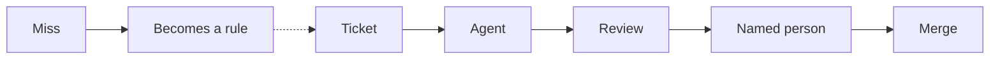

<p align="center">
  <a href="https://apexyard.ai"></a>
</p>

<h1 align="center">ApexYard</h1>

<p align="center">
  <strong>Your agents write the code. Your process decides what merges.</strong>
</p>

<p align="center">
  <a href="https://github.com/me2resh/apexyard/releases"></a>
  <a href="LICENSE"></a>
  <a href="https://apexyard.ai"></a>
  <a href="https://github.com/me2resh/apexyard/stargazers"></a>
</p>

ApexYard gives your agents a team's process: tickets, plans, reviews, and your
rules. Then it checks every pull request, and merge stays closed until a named
person approves the exact commit.

- **Before the code:** a ticket, a plan, and the rules guide the agent.
- **After the code:** an independent review runs, and merge stays closed until a
  named person approves the exact commit.
- **When something slips through:** the miss becomes a rule. Next time the rule
  guides the agent and the gate checks for it.

The framework runs in your repo as plain Markdown and shell. You fork it,
register your projects in one registry, and work across the portfolio from that
ops repo. Claude Code is the default driver. Other coding tools can use the same
rules through a small adapter.

<!-- DEMO_GIF: short demo recording goes here when available. Do not invent an image. -->



## Contents

- [What makes it different](#what-makes-it-different)
- [What is inside](#what-is-inside)
- [Quick start](#quick-start)
- [Using another AI coding tool?](#using-another-ai-coding-tool)
- [Further reading](#further-reading)
- [Customization](#customization)
- [Contributing](#contributing)
- [Contributors](#contributors)
- [License](#license)

## What makes it different

| Area | Without ApexYard | With ApexYard |
|---|---|---|
| Code review | Ad-hoc prompts | Rex reviews every pull request. |
| Technical decisions | Lost in chat | Agent Decision Records preserve them. |
| Quality gates | Manual memory | Shell hooks block unsafe actions. |
| Merge approval | Informal LGTM | Rex and a named person approve the exact commit. |
| Misses | The same miss repeats | The miss becomes a rule the agent and the gate both use. |

More rows (migrations, architecture, portfolio view, upstream sync, roles,
onboarding): [`docs/whats-inside.md`](docs/whats-inside.md#more-ways-apexyard-differs).

## What is inside

Roles, hooks, skills, sub-agents, rules, workflows, and templates. Full
directory layout and component list:
[`docs/whats-inside.md`](docs/whats-inside.md).

## Quick start

Fork the ops repo, open it in your agent tool, then configure and register a
project:

```bash
gh repo fork me2resh/apexyard --clone
cd apexyard
# In your agent tool:
#   /setup
#   /handover <repo>
#   /inbox
```

`/setup` writes local config. `/handover` scores and registers a project.
`/inbox` lists what needs your attention across the portfolio.

Full setup guide (directory layout, daily workflow, FAQ):
[`docs/multi-project.md`](docs/multi-project.md).
CLI install and `apexyard init` (including private ops repos):
[`docs/getting-started.md`](docs/getting-started.md).
Keep a fork current with [`docs/upgrading.md`](docs/upgrading.md).

## Using another AI coding tool?

Claude Code is the default driver. The same rules reach other tools through a
small adapter. Dated proof and limits live in
[`docs/harnesses/`](docs/harnesses/).

| Tool | Status | Setup |
|------|--------|-------|
| Claude Code | Native | Nothing extra. Run `/setup`. |
| opencode | Proven | `bash bin/install-opencode-adapter.sh` |
| pi | Proven | `bash bin/install-pi-adapter.sh` |
| Codex | Proven | `bash bin/sync-codex-adapter.sh` |
| Cursor | Native in the IDE | Enable third-party configs, then `bash bin/install-cursor-adapter.sh` |

## Further reading

- Site move note: [`docs/whats-inside.md`](docs/whats-inside.md#marketing-site)
- Roles, workflows, and templates: [`docs/whats-inside.md`](docs/whats-inside.md#roles)
- Project badges: [`docs/badges.md`](docs/badges.md)
- Status band above the prompt: [`docs/status-band.md`](docs/status-band.md)
- For AI coding agents: [`AGENTS.md`](AGENTS.md)

Built on two open standards: [AgDR](https://agdr.dev) and
[ORBIT](https://orbitspec.dev).

## Customization

Edit roles under `roles/`, workflows under `workflows/`, and templates under
`templates/`. The stack is Markdown files. Change what you need.

## Contributing

Read [CONTRIBUTING.md](CONTRIBUTING.md) for the fork, branch, PR, and review flow.
Open a Bug report or Feature request issue.
The [Code of Conduct](CODE_OF_CONDUCT.md) applies to all participation.
Report security issues in [SECURITY.md](SECURITY.md). Do not open a public issue for those.

## Contributors

Thanks to everyone who contributes code, documentation, bug reports, ideas, and feedback.

<p>
<a href="https://github.com/me2resh" title="me2resh"></a>
<a href="https://github.com/AbdElrahmaN31" title="AbdElrahmaN31"></a>
<a href="https://github.com/HishamM1" title="HishamM1"></a>
<a href="https://github.com/tifa64" title="tifa64"></a>
<a href="https://github.com/hossam-96" title="hossam-96"></a>
<a href="https://github.com/aniketshukla1" title="aniketshukla1"></a>
<a href="https://github.com/ahmedashraffcih" title="ahmedashraffcih"></a>
<a href="https://github.com/ahmedk20" title="ahmedk20"></a>
<a href="https://github.com/moussaws" title="moussaws"></a>
<a href="https://github.com/a-abdellatif98" title="a-abdellatif98"></a>
<a href="https://github.com/AhmedTheGeek" title="AhmedTheGeek"></a>
<a href="https://github.com/MohammedEl-sayedAhmed" title="MohammedEl-sayedAhmed"></a>
<a href="https://github.com/NagyWesley" title="NagyWesley"></a>
</p>

### Issue contributors

Thank you to everyone who opened issues, including bug reports, feature requests, questions, and documentation feedback.

<p>
<a href="https://github.com/me2resh/apexyard/issues?q=is%3Aissue%20author%3Aa-abdellatif98" title="a-abdellatif98"></a>
<a href="https://github.com/me2resh/apexyard/issues?q=is%3Aissue%20author%3Aa-elnemr" title="a-elnemr"></a>
<a href="https://github.com/me2resh/apexyard/issues?q=is%3Aissue%20author%3Aabbaseya" title="abbaseya"></a>
<a href="https://github.com/me2resh/apexyard/issues?q=is%3Aissue%20author%3AAbdelrahman-Shahda" title="Abdelrahman-Shahda"></a>
<a href="https://github.com/me2resh/apexyard/issues?q=is%3Aissue%20author%3AAbdElrahmaN31" title="AbdElrahmaN31"></a>
<a href="https://github.com/me2resh/apexyard/issues?q=is%3Aissue%20author%3Aaelnemr" title="aelnemr"></a>
<a href="https://github.com/me2resh/apexyard/issues?q=is%3Aissue%20author%3Aahmedashraffcih" title="ahmedashraffcih"></a>
<a href="https://github.com/me2resh/apexyard/issues?q=is%3Aissue%20author%3Aahmedgemi" title="ahmedgemi"></a>
<a href="https://github.com/me2resh/apexyard/issues?q=is%3Aissue%20author%3AAhmedTheGeek" title="AhmedTheGeek"></a>
<a href="https://github.com/me2resh/apexyard/issues?q=is%3Aissue%20author%3Aahmedwael216" title="ahmedwael216"></a>
<a href="https://github.com/me2resh/apexyard/issues?q=is%3Aissue%20author%3Aalalm3i" title="alalm3i"></a>
<a href="https://github.com/me2resh/apexyard/issues?q=is%3Aissue%20author%3Aasami-me" title="asami-me"></a>
<a href="https://github.com/me2resh/apexyard/issues?q=is%3Aissue%20author%3Aatlas-apex" title="atlas-apex"></a>
<a href="https://github.com/me2resh/apexyard/issues?q=is%3Aissue%20author%3Aaureyia" title="aureyia"></a>
<a href="https://github.com/me2resh/apexyard/issues?q=is%3Aissue%20author%3Abatout" title="batout"></a>
<a href="https://github.com/me2resh/apexyard/issues?q=is%3Aissue%20author%3Abitwhispererrr" title="bitwhispererrr"></a>
<a href="https://github.com/me2resh/apexyard/issues?q=is%3Aissue%20author%3Aborzoj" title="borzoj"></a>
<a href="https://github.com/me2resh/apexyard/issues?q=is%3Aissue%20author%3ADr-kersho" title="Dr-kersho"></a>
<a href="https://github.com/me2resh/apexyard/issues?q=is%3Aissue%20author%3Adrmas" title="drmas"></a>
<a href="https://github.com/me2resh/apexyard/issues?q=is%3Aissue%20author%3Aeibrahim95" title="eibrahim95"></a>
<a href="https://github.com/me2resh/apexyard/issues?q=is%3Aissue%20author%3Aengnaruto" title="engnaruto"></a>
<a href="https://github.com/me2resh/apexyard/issues?q=is%3Aissue%20author%3Ahamoda-dev" title="hamoda-dev"></a>
<a href="https://github.com/me2resh/apexyard/issues?q=is%3Aissue%20author%3Ahazemahmedx0" title="hazemahmedx0"></a>
<a href="https://github.com/me2resh/apexyard/issues?q=is%3Aissue%20author%3AHC12026" title="HC12026"></a>
<a href="https://github.com/me2resh/apexyard/issues?q=is%3Aissue%20author%3AHishamM1" title="HishamM1"></a>
<a href="https://github.com/me2resh/apexyard/issues?q=is%3Aissue%20author%3AHOSS11H" title="HOSS11H"></a>
<a href="https://github.com/me2resh/apexyard/issues?q=is%3Aissue%20author%3Ahossam-96" title="hossam-96"></a>
<a href="https://github.com/me2resh/apexyard/issues?q=is%3Aissue%20author%3Aibrahim-gad" title="ibrahim-gad"></a>
<a href="https://github.com/me2resh/apexyard/issues?q=is%3Aissue%20author%3Ajafarguzman666-ops" title="jafarguzman666-ops"></a>
<a href="https://github.com/me2resh/apexyard/issues?q=is%3Aissue%20author%3AKarimEbrahemAbdelaziz" title="KarimEbrahemAbdelaziz"></a>
<a href="https://github.com/me2resh/apexyard/issues?q=is%3Aissue%20author%3Akhaledmedra" title="khaledmedra"></a>
<a href="https://github.com/me2resh/apexyard/issues?q=is%3Aissue%20author%3Amabdelaziz77" title="mabdelaziz77"></a>
<a href="https://github.com/me2resh/apexyard/issues?q=is%3Aissue%20author%3Amahmoudsobhy74" title="mahmoudsobhy74"></a>
<a href="https://github.com/me2resh/apexyard/issues?q=is%3Aissue%20author%3AManito2z" title="Manito2z"></a>
<a href="https://github.com/me2resh/apexyard/issues?q=is%3Aissue%20author%3AMedNewton" title="MedNewton"></a>
<a href="https://github.com/me2resh/apexyard/issues?q=is%3Aissue%20author%3AMeDoTarek73" title="MeDoTarek73"></a>
<a href="https://github.com/me2resh/apexyard/issues?q=is%3Aissue%20author%3AMina4lfy" title="Mina4lfy"></a>
<a href="https://github.com/me2resh/apexyard/issues?q=is%3Aissue%20author%3AmohamedELamine" title="mohamedELamine"></a>
<a href="https://github.com/me2resh/apexyard/issues?q=is%3Aissue%20author%3AMohammedEl-sayedAhmed" title="MohammedEl-sayedAhmed"></a>
<a href="https://github.com/me2resh/apexyard/issues?q=is%3Aissue%20author%3Amosta7il" title="mosta7il"></a>
<a href="https://github.com/me2resh/apexyard/issues?q=is%3Aissue%20author%3Amostiwheelietravel" title="mostiwheelietravel"></a>
<a href="https://github.com/me2resh/apexyard/issues?q=is%3Aissue%20author%3Amoussaws" title="moussaws"></a>
<a href="https://github.com/me2resh/apexyard/issues?q=is%3Aissue%20author%3Amuhammadattia95" title="muhammadattia95"></a>
<a href="https://github.com/me2resh/apexyard/issues?q=is%3Aissue%20author%3ANagyWesley" title="NagyWesley"></a>
<a href="https://github.com/me2resh/apexyard/issues?q=is%3Aissue%20author%3Anickyreinert" title="nickyreinert"></a>
<a href="https://github.com/me2resh/apexyard/issues?q=is%3Aissue%20author%3AnLoops" title="nLoops"></a>
<a href="https://github.com/me2resh/apexyard/issues?q=is%3Aissue%20author%3AOmar-Elhorbity" title="Omar-Elhorbity"></a>
<a href="https://github.com/me2resh/apexyard/issues?q=is%3Aissue%20author%3AOmarEhab007" title="OmarEhab007"></a>
<a href="https://github.com/me2resh/apexyard/issues?q=is%3Aissue%20author%3AOmarElaraby26" title="OmarElaraby26"></a>
<a href="https://github.com/me2resh/apexyard/issues?q=is%3Aissue%20author%3Aosama-abu-baker" title="osama-abu-baker"></a>
<a href="https://github.com/me2resh/apexyard/issues?q=is%3Aissue%20author%3AOsamaAlSabry" title="OsamaAlSabry"></a>
<a href="https://github.com/me2resh/apexyard/issues?q=is%3Aissue%20author%3Apsmend" title="psmend"></a>
<a href="https://github.com/me2resh/apexyard/issues?q=is%3Aissue%20author%3Arafik-wahid-cubeish" title="rafik-wahid-cubeish"></a>
<a href="https://github.com/me2resh/apexyard/issues?q=is%3Aissue%20author%3ARef34t" title="Ref34t"></a>
<a href="https://github.com/me2resh/apexyard/issues?q=is%3Aissue%20author%3Asamahali" title="samahali"></a>
<a href="https://github.com/SecFathy" title="SecFathy"></a>
<a href="https://github.com/me2resh/apexyard/issues?q=is%3Aissue%20author%3Asts1078" title="sts1078"></a>
<a href="https://github.com/me2resh/apexyard/issues?q=is%3Aissue%20author%3Asudanese" title="sudanese"></a>
<a href="https://github.com/me2resh/apexyard/issues?q=is%3Aissue%20author%3Atifa64" title="tifa64"></a>
<a href="https://github.com/me2resh/apexyard/issues?q=is%3Aissue%20author%3Avjcv26" title="vjcv26"></a>
<a href="https://github.com/me2resh/apexyard/issues?q=is%3Aissue%20author%3Ayehiagamalx" title="yehiagamalx"></a>
<a href="https://github.com/me2resh/apexyard/issues?q=is%3Aissue%20author%3AYOoOUNiieeSS" title="YOoOUNiieeSS"></a>
<a href="https://github.com/me2resh/apexyard/issues?q=is%3Aissue%20author%3Azeyadsleem" title="zeyadsleem"></a>
<a href="https://github.com/me2resh/apexyard/issues?q=is%3Aissue%20author%3AZiadHosny" title="ZiadHosny"></a>
</p>

When updating these credits, include new issue authors as well as pull-request contributors.
Use public GitHub handles and links. Describe each contribution accurately.

## License

MIT License. See [LICENSE](LICENSE) for details.
