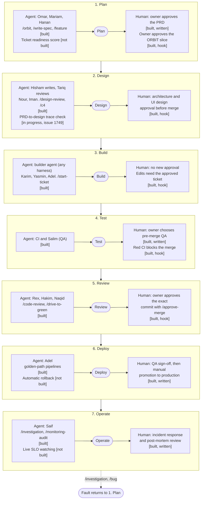

# SDLC at a glance

This page shows the seven stages of the ApexYard software development lifecycle (SDLC) in one place.
For each stage, it shows the agent that does the work and the human checkpoint that approves it.
The [full SDLC workflow](../workflows/sdlc.md) gives the details of each stage.
The [workflow gates](../.claude/rules/workflow-gates.md) give the gate numbers.

Each cell has one of these marks:

- **Built:** the framework ships it. "Hook" means a hook blocks the action until the check passes. "Written" means a rule, role or workflow file states it, and no hook checks it.
- **In progress:** a pull request (PR) for it is open. The mark names the issue.
- **Not built:** nothing exists yet.

## Diagram

Each row is one stage. Read a row from left to right: the agent, the stage, and the human checkpoint.
Faults in Operate return to Plan through `/investigation` and `/bug`.

## Stage by stage

This table gives the same content as the diagram, with links.

| Stage | Agent, skill and gate | Human checkpoint | Not built or in progress |
| --- | --- | --- | --- |
| Plan | [Omar](../roles/product/head-of-product.md), [Mariam](../roles/product/product-manager.md) and [Hanan](../roles/product/product-analyst.md) use [/orbit](../.claude/skills/orbit/SKILL.md), [/validate-idea](../.claude/skills/validate-idea/SKILL.md), [/write-spec](../.claude/skills/write-spec/SKILL.md), [/plan-initiative](../.claude/skills/plan-initiative/SKILL.md) and [/feature](../.claude/skills/feature/SKILL.md). **Built.** | The owner approves the PRD (gate 1). **Built, written:** no hook checks a PRD. With ORBIT on, the owner approves each slice in its records PR. A Feature or Task ticket needs a merged slice record. **Built, hook:** [require-orbit-slice-for-ticket.sh](../.claude/hooks/require-orbit-slice-for-ticket.sh). | A score that says a ticket is ready to build. **Not built.** |
| Design | [Hisham](../roles/engineering/tech-lead.md) writes the technical design. [Tariq](../roles/architecture/solution-architect.md) reviews it with [/design-review](../.claude/skills/design-review/SKILL.md). [Nour](../roles/design/ui-designer.md) and [Iman](../roles/design/ux-designer.md) own the UI and the user flows. Skills: [/c4](../.claude/skills/c4/SKILL.md), [/dfd](../.claude/skills/dfd/SKILL.md), [/threat-model](../.claude/skills/threat-model/SKILL.md). **Built.** | A PR with a design artifact needs an architecture approval before merge (gate 3b). Tariq writes it on approval, or a person runs [/approve-architecture](../.claude/skills/approve-architecture/SKILL.md). **Built, hook:** [require-architecture-review.sh](../.claude/hooks/require-architecture-review.sh). A PR with UI files needs [/approve-design](../.claude/skills/approve-design/SKILL.md) before merge. **Built, hook:** [require-design-review-for-ui.sh](../.claude/hooks/require-design-review-for-ui.sh). | A check that each PRD requirement maps to a design task. **In progress:** [#1749](https://github.com/me2resh/apexyard/issues/1749). |
| Build | Builder agent (any harness): [Karim](../roles/engineering/backend-engineer.md), [Yasmin](../roles/engineering/frontend-engineer.md) or [Adel](../roles/engineering/platform-engineer.md). [/start-ticket](../.claude/skills/start-ticket/SKILL.md) records the ticket. It can also run a configured check on the base commit. Architecture changes need an Agent Decision Record from [/decide](../.claude/skills/decide/SKILL.md). **Built.** | No new human approval at this stage. The owner approved the ticket at Plan. Code edits need an active ticket (gate 3). **Built, hook:** [require-active-ticket.sh](../.claude/hooks/require-active-ticket.sh). A commit that changes architecture files needs an Agent Decision Record. **Built, hook:** [require-agdr-for-arch-changes.sh](../.claude/hooks/require-agdr-for-arch-changes.sh). | None. |
| Test | The project's CI runs the tests. [Salim](../roles/engineering/qa-engineer.md) checks each acceptance criterion at the PR head. **Built.** | After Rex approves, [/code-review](../.claude/skills/code-review/SKILL.md) asks the owner whether Salim runs QA before merge. **Built, written:** pre-merge QA is not a merge gate. A PR with red CI cannot merge. **Built, hook:** [block-merge-on-red-ci.sh](../.claude/hooks/block-merge-on-red-ci.sh). Coverage above 80% (gate 4). **Built, written:** the framework does not measure coverage. A project's own CI can measure it. | None. |
| Review | [Rex](../.claude/agents/code-reviewer.md) reviews every PR with [/code-review](../.claude/skills/code-review/SKILL.md). [Hakim](../.claude/agents/security-reviewer.md) reviews security-sensitive PRs with [/security-review](../.claude/skills/security-review/SKILL.md). [Naqid](../.claude/agents/contrarian.md) gives advice through [/challenge](../.claude/skills/challenge/SKILL.md). [/drive-to-green](../.claude/skills/drive-to-green/SKILL.md) drives one PR through CI, review and fixes, and stops before the human approval. [/pr-status](../.claude/skills/pr-status/SKILL.md) shows the gate state of one PR. **Built.** | A PR cannot merge without Rex's approval at its head and the owner's approval of that PR through [/approve-merge](../.claude/skills/approve-merge/SKILL.md) (gate 5). **Built, hook:** [block-unreviewed-merge.sh](../.claude/hooks/block-unreviewed-merge.sh). No merge gate checks a Hakim review. Naqid's advice never blocks a gate. | None. |
| Deploy | [Adel](../roles/engineering/platform-engineer.md) owns the pipelines. Projects copy the [golden-path pipelines](../golden-paths/pipelines/README.md). **Built.** | Salim verifies the acceptance criteria and signs off before the ticket moves to Done (gate 6). A person then promotes the change from staging to production by hand. [Khalid](../roles/engineering/head-of-engineering.md) signs off risky changes. **Built, written:** the [deployment process](../workflows/deployment.md). No hook checks the sign-off or the promotion. | A gate that enforces the production promotion. **Not built.** Automatic rollback. **Not built.** |
| Operate | [Saif](../roles/engineering/sre.md) runs the incident steps. [/investigation](../.claude/skills/investigation/SKILL.md) runs the root-cause work. [/monitoring-audit](../.claude/skills/monitoring-audit/SKILL.md) and [/launch-check](../.claude/skills/launch-check/SKILL.md) check readiness before launch. **Built.** | The team follows the [incident steps](../roles/engineering/sre.md#incident-response) and reviews a post-mortem within 48 hours. **Built, written:** no hook checks it. | Live service-level objective (SLO) watching. **Not built.** Paging. **Not built.** An incident skill. **Not built.** |

The feedback loop returns faults from Operate to Plan.
Use [/investigation](../.claude/skills/investigation/SKILL.md) for sustained root-cause work.
Use [/bug](../.claude/skills/bug/SKILL.md) to file a fault as a ticket.

The [/release](../.claude/skills/release/SKILL.md) skill releases the ApexYard framework itself. It does not deploy a managed project.

## Where ApexYard is strong and where it is thin

- **Strong:** Design, Build and Review. Hooks block a merge without the required reviews and human approvals.
- **Medium:** Plan and Test. Hooks check the ORBIT slice and red CI. The PRD approval and the coverage rule have no hook.
- **Thin:** Deploy and Operate. The framework has written processes for them. It has no hooks or tools that act on a live service.

The [gate state contract](gate-state-contract.md) lists the records that each gate reads and writes.
