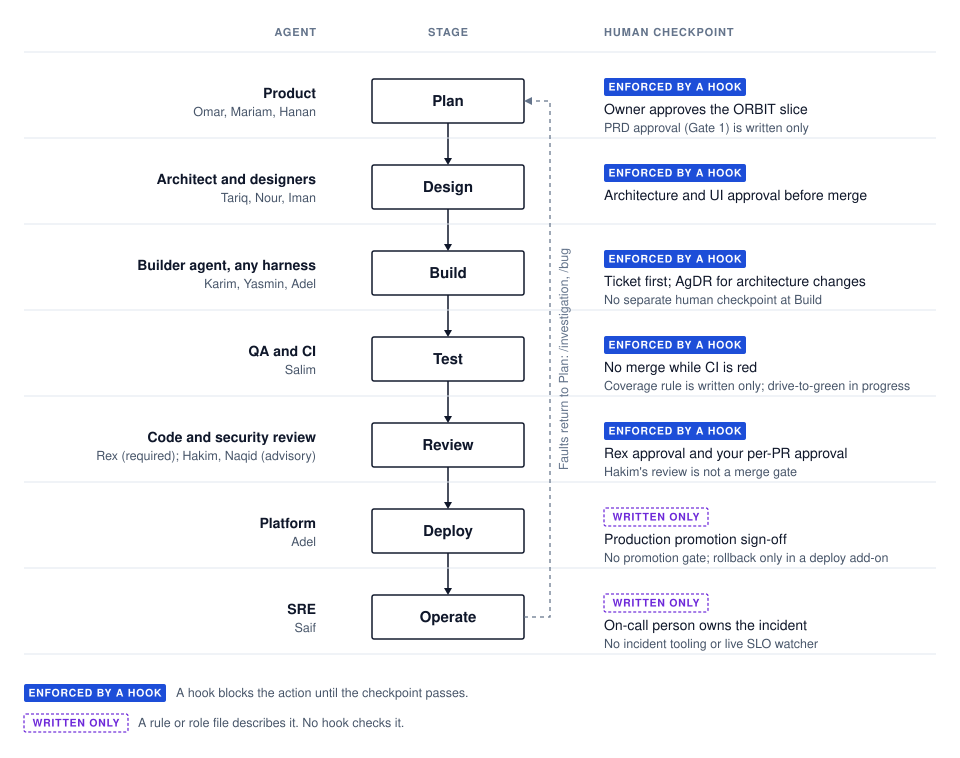

# SDLC at a glance

For each stage of the software development lifecycle (SDLC), this page shows the agent that does the work and the human checkpoint that approves it. It also shows how strong each control is. The seven stages summarize the [full SDLC workflow](../workflows/sdlc.md).

Each control has one of these levels:

- **Enforced:** a hook blocks the action until the control passes.
- **Written:** a rule or role file describes it, but no hook checks it.
- **Not built:** nothing exists yet.

Read each row from left to right. The agent does the work at the stage, and the checkpoint on the right approves it. A blue label means a hook enforces the checkpoint. A dashed purple label means it is written only.

## Stage by stage

| Stage | Agent | Enforced | Written only | Not built |
| --- | --- | --- | --- | --- |
| Plan | [Omar](../roles/product/head-of-product.md), [Mariam](../roles/product/product-manager.md), [Hanan](../roles/product/product-analyst.md). Skills: [/orbit](../.claude/skills/orbit/SKILL.md), [/validate-idea](../.claude/skills/validate-idea/SKILL.md), [/write-spec](../.claude/skills/write-spec/SKILL.md), [/plan-initiative](../.claude/skills/plan-initiative/SKILL.md). | With ORBIT on, a Feature or Task ticket needs a merged slice record ([hook](../.claude/hooks/require-orbit-slice-for-ticket.sh)). The owner approves the slice in its records PR. | Gate 1, "PRD approved", in [CLAUDE.md](../CLAUDE.md#workflows). No hook checks a PRD. | A score that says a ticket is ready to build. |
| Design | [Tariq](../roles/architecture/solution-architect.md), [Nour](../roles/design/ui-designer.md), [Iman](../roles/design/ux-designer.md). Skills: [/design-review](../.claude/skills/design-review/SKILL.md), [/c4](../.claude/skills/c4/SKILL.md), [/dfd](../.claude/skills/dfd/SKILL.md), [/threat-model](../.claude/skills/threat-model/SKILL.md). | A PR with design artifacts cannot merge without [/approve-architecture](../.claude/skills/approve-architecture/SKILL.md) ([hook](../.claude/hooks/require-architecture-review.sh)). A PR with UI files cannot merge without [/approve-design](../.claude/skills/approve-design/SKILL.md) ([hook](../.claude/hooks/require-design-review-for-ui.sh)). | When to run a design review before Build. | None. |
| Build | Builder agent through any harness: [Karim](../roles/engineering/backend-engineer.md), [Yasmin](../roles/engineering/frontend-engineer.md), [Adel](../roles/engineering/platform-engineer.md). | Code edits need an active ticket ([/start-ticket](../.claude/skills/start-ticket/SKILL.md), [hook](../.claude/hooks/require-active-ticket.sh)). Architecture changes need an Agent Decision Record ([/decide](../.claude/skills/decide/SKILL.md)). | One ticket per PR. | A human checkpoint at Build itself. The owner approves earlier, at Plan. |
| Test | [QA Salim](../roles/engineering/qa-engineer.md) and CI. | A PR with red CI cannot merge ([hook](../.claude/hooks/block-merge-on-red-ci.sh)). | Coverage above 80% (Gate 2). The framework does not measure coverage; a project's own CI can. QA before merge is an optional offer. | An automatic loop that drives a PR to green CI and a clean review ([#1996](https://github.com/me2resh/apexyard/issues/1996), in progress). |
| Review | [Rex](../.claude/agents/code-reviewer.md) (required), [Hakim](../.claude/agents/security-reviewer.md), [Naqid](../.claude/agents/contrarian.md). Skills: [/code-review](../.claude/skills/code-review/SKILL.md), [/security-review](../.claude/skills/security-review/SKILL.md), [/challenge](../.claude/skills/challenge/SKILL.md). | A PR cannot merge without Rex's approval at its head, and the human's per-PR approval through [/approve-merge](../.claude/skills/approve-merge/SKILL.md) ([hook](../.claude/hooks/block-unreviewed-merge.sh)). | Hakim reviews security-sensitive PRs by policy, but no merge gate requires his approval. Naqid is advisory. Gate 4, QA after merge, is written. | None. |
| Deploy | [Adel](../roles/engineering/platform-engineer.md). | None. | The [deployment process](../workflows/deployment.md): a push to `main` deploys to staging; promotion to production is manual after QA, with sign-off. Projects copy the [golden-path pipelines](../golden-paths/pipelines/README.md). | A gate that enforces the production promotion. Rollback exists only in an optional premium deploy add-on. |
| Operate | [Saif](../roles/engineering/sre.md). | None. | The [incident steps](../roles/engineering/sre.md#incident-response): detect, respond, mitigate, resolve and review, with a severity table and a post-mortem template. [/investigation](../.claude/skills/investigation/SKILL.md) runs the root-cause work. [/monitoring-audit](../.claude/skills/monitoring-audit/SKILL.md) and [/launch-check](../.claude/skills/launch-check/SKILL.md) check readiness before launch. | An incident skill, paging, and a live service-level objective (SLO) watcher. |

The framework uses [/release](../.claude/skills/release/SKILL.md) for its own releases. See the [release process](release-process.md). That skill is for the ApexYard framework only, not for managed projects.

The feedback loop uses [/investigation](../.claude/skills/investigation/SKILL.md) and [/bug](../.claude/skills/bug/SKILL.md) to return faults to Plan.

## Where ApexYard is strong and where it is thin

- **Strong:** Design, Build and Review. Hooks block a merge without the required reviews and human approvals.
- **Medium:** Plan and Test. The slice and CI checks are enforced. PRD approval and coverage are written only.
- **Thin:** Deploy and Operate. They have written processes but no enforcement or tooling in the core framework.
