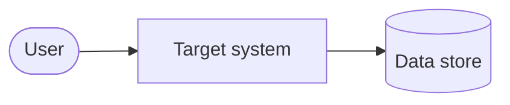

<!-- When this template creates an artifact, use the controlled technical writing profile in .claude/rules/writing-standard.md. -->

<!-- Source: ApexYard · templates/architecture/vision-appendix.md · github.com/me2resh/apexyard · MIT -->

# Heavy appendix: {Project Name}

> Optional. Add this appendix to the one-page vision only when the project needs the depth, for example a regulated product or a large team. The one-page vision is the default.
>
> The same rules apply: a section that does not apply says `Not relevant: <reason>`. Every number has a source and a date, or is labelled `(estimate)`. An unknown value is `not set (owner: <name>)`.
>
> This appendix has no trace IDs. Name each item in plain words.

## Business context

[Who uses the system, what the business needs from it, and what success looks like.]

## Capabilities

[The capabilities the system provides. One line each.]

## Load and growth

| Measure | Today | In 12 months | Source and date |
|---------|-------|--------------|-----------------|
| [For example: active users] | [value] | [value, or "(estimate)"] | [source and date] |

## Data and processors

| Data | Classification | Where it flows | Processor | Source and date |
|------|----------------|----------------|-----------|-----------------|
| [For example: customer email] | [class] | [from, to] | [vendor] | [source and date] |

## Legal and regulatory

[Laws, contracts and standards that bind the system, and what each one requires.]

## Security posture

[Trust boundaries, identity, secrets handling and known gaps.]

## Organisation and operations

[Who builds and runs the system, on-call cover and the team's skills.]

## Limits and assumptions

[Hard limits (budget, team size, vendor quotas) and the assumptions that the design depends on.]

## Alternatives

| Need | Reuse | Configure | Buy | Build | Choice |
|------|-------|-----------|-----|-------|--------|
| [need] | [existing part] | [setting or option] | [vendor] | [custom work] | [which one, and why] |

## Decisions

[The main decisions, each with a link to its decision record.]

## Cost model

| Cost line | Today per month | Driver | Source and date |
|-----------|-----------------|--------|-----------------|
| [For example: compute] | [value] | [what makes it grow] | [source and date] |

## Trade-offs

[What the design gives up for each driver, and why that is acceptable.]

## Risks

| Risk | Likelihood | Impact | Owner | Response |
|------|------------|--------|-------|----------|
| [risk] | [level] | [level] | [name] | [response] |

## Target state

[Where the architecture is going: the containers and integrations at the end of the migration path. This is a choice: the operator writes it. Add a Mermaid diagram when it helps. `/c4` draws the current state, not this one.]

## Migration path

| Quarter | Milestone | Owner | Done when |
|---------|-----------|-------|-----------|
| [quarter] | [milestone] | [name] | [a check that someone can run] |

## Fitness functions and review triggers

[Automated checks that keep the design true, and the events that force a review of this vision. Review at least once a quarter.]
